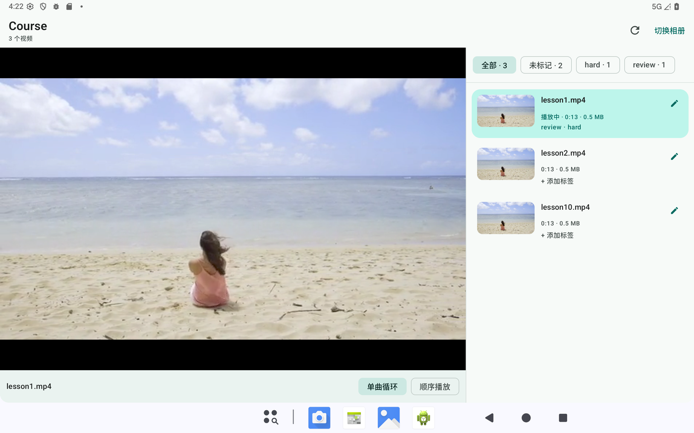
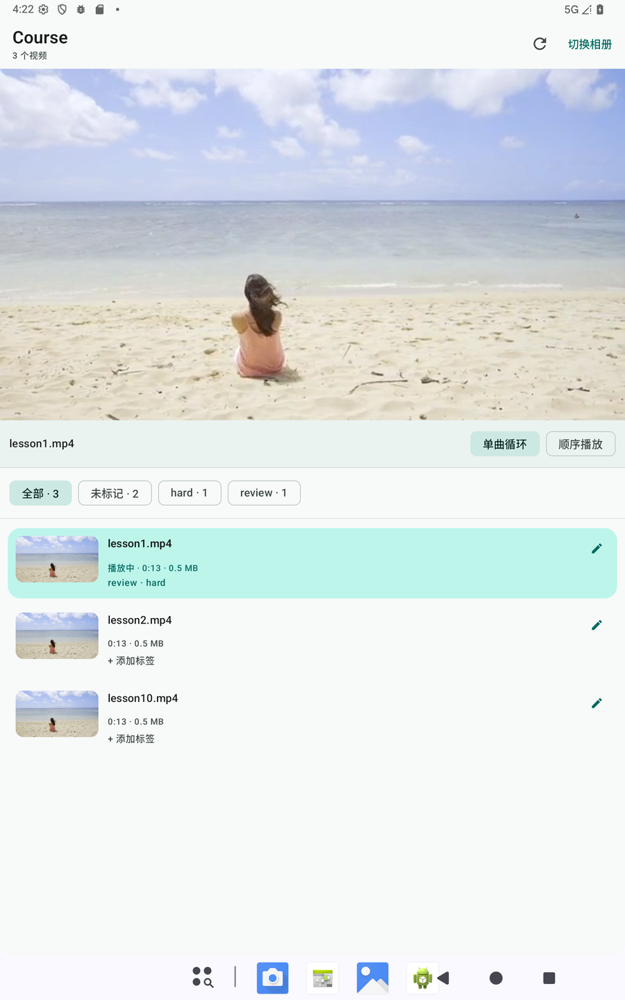
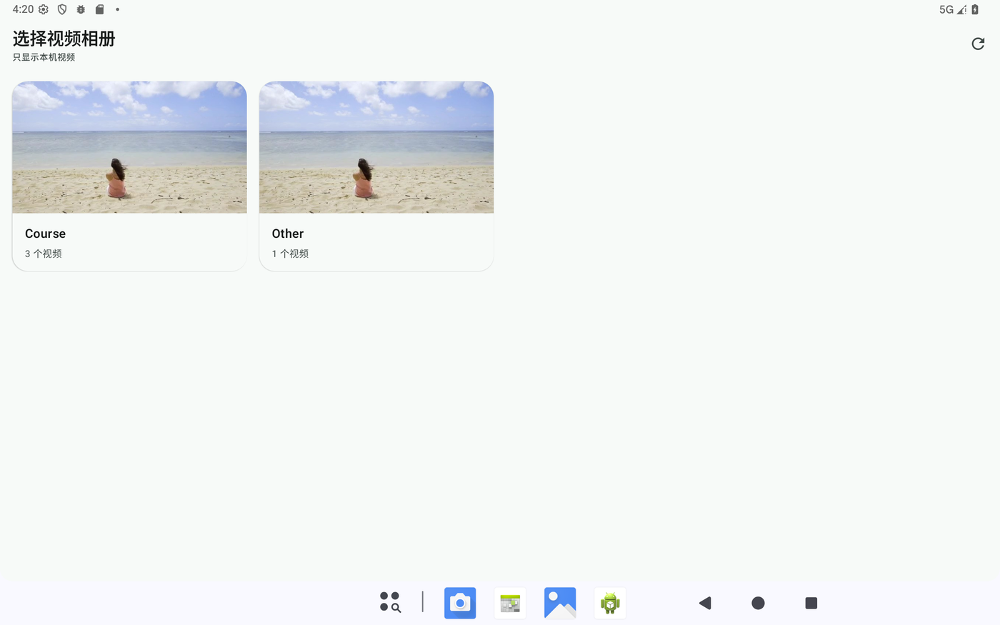
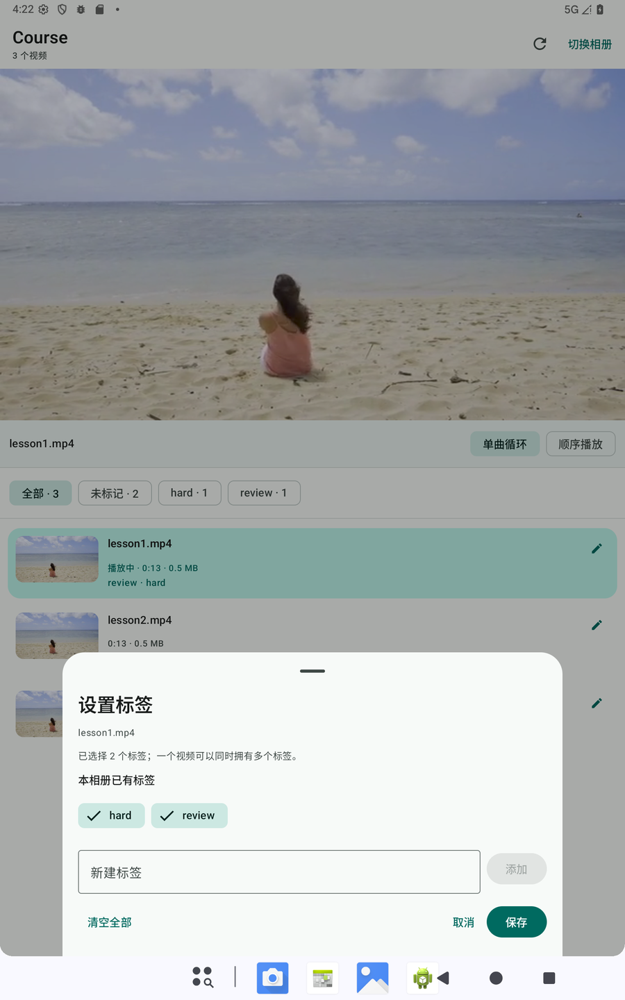

# VideoCoursePlayer

VideoCoursePlayer 是一个面向**本地课程视频**的 Android 播放器。用户首次启动时从系统相册中选择一个视频相册，之后即可在同一个界面中浏览视频、给视频打多个标签、按标签筛选，并按列表顺序连续播放或单曲循环。

> **当前状态（2026-11-09）**：MVP 已实现，并在 Pixel Tablet API 36 模拟器上完成 Debug 与 Release 实测；单元测试、`lintDebug` 和 R8 Release 构建均通过。可安装 APK 见 [Releases](https://github.com/guxin0123/VideoCoursePlayer/releases/latest)（APK 不再纳入版本库）。详细的实现状态与验证记录见 [开发计划](DEVELOPMENT_PLAN.md)。

## 下载

安装包通过 [GitHub Releases](https://github.com/guxin0123/VideoCoursePlayer/releases/latest) 分发，仓库只保留源码：

- [VideoCoursePlayer-1.0.apk](https://github.com/guxin0123/VideoCoursePlayer/releases/download/v1.0.0/VideoCoursePlayer-1.0.apk)（v1.0.0，约 6.6 MB）
- Release 页面同时提供 `VideoCoursePlayer-1.0.apk.sha256` 校验文件

> 该 APK 使用本机调试证书签名，仅供本地安装测试，不是应用商店发布包；正式分发请替换为自己的 Release 签名。

## 界面预览

| 横屏主界面 | 竖屏主界面 |
| --- | --- |
|  |  |

| 相册选择 | 多标签编辑 |
| --- | --- |
|  |  |

## 目标场景

- 课程视频已经按相册/文件夹整理在手机或平板本地。
- 用户希望固定只看某一个相册，而不是每次从整个媒体库中找文件。
- 用户希望用多个简单标签整理课程，例如“待复习”“重点”“已完成”，并快速筛选。
- 用户希望视频能按列表顺序自动连播，或反复观看当前一节。

## 功能范围（MVP）

| 能力 | MVP 行为 |
| --- | --- |
| 首次选择相册 | 首次启动申请视频读取权限，展示本地视频相册；选择后记住该相册，后续启动直接进入主界面 |
| 更换相册 | 主界面可重新进入相册选择页；已选相册被删除或权限被撤销时自动回到选择页 |
| 响应式主界面 | 竖屏为播放器在上、列表在下；横屏为播放器与列表左右双栏；列表独立滚动 |
| 视频列表 | 展示相册内视频的缩略图、文件名、时长和标签摘要；默认按文件名自然升序排列，例如 `第2课` 在 `第10课` 之前 |
| 视频播放 | 点击列表项即播放；使用 Media3 ExoPlayer，内置控制条支持播放/暂停、进度拖动和时间显示 |
| 单曲循环 | 当前视频播放结束后从头继续播放当前视频 |
| 顺序播放 | 按本次播放队列依次播放；最后一节结束后停止，不自动跳回第一节 |
| 视频标签 | 每个视频可设置多个自由文本标签，可通过底部面板多选已有标签、新建标签或移除标签 |
| 标签筛选 | 按“全部 / 未标记 / 某个标签”筛选列表；带多个标签的视频会出现在其任一标签下；筛选结果同时决定下一次播放的队列 |
| 本地持久化 | 已选相册、标签和播放模式保存在本机；不联网、不上传媒体 |
| 基础健壮性 | 覆盖无权限、受限访问、空相册、筛选无结果、视频播放失败、旋转屏幕等状态 |

### MVP 暂不包含

- 标签颜色、标签重命名/删除/合并管理页、多标签组合筛选（AND/OR）。
- 在线视频、云盘相册、DRM 视频、字幕、倍速、后台播放和画中画。
- 视频编辑、转码、下载和文件管理。
- 搜索、自定义排序、播放进度续播、跨设备同步。

## 使用流程

1. 首次启动：阅读权限说明并授予视频访问权限。
2. 相册选择页：从系统媒体库的本地视频相册中选择一个相册。
3. 主界面：浏览该相册中的视频，点击任意视频开始播放。
4. 标签：点击列表项上的标签按钮，多选已有标签或输入新标签。
5. 筛选：点击顶部标签筛选条，只看某个标签或未标记的视频。
6. 播放模式：在播放器下方切换“单曲循环 / 顺序播放”。
7. 退出：按一次返回键显示“再按一次返回退出应用”，2 秒内再次按返回键退出；标签面板等弹层会优先关闭。

## 界面布局

### 竖屏

```text
┌──────────────────────────────────┐
│ 相册名称 ▾                 切换相册 │
├──────────────────────────────────┤
│                                  │
│        视频播放区域 16:9          │
│                                  │
│   [单曲循环]  [顺序播放]           │
├──────────────────────────────────┤
│ 全部   未标记   重点   已完成 ...  │
├──────────────────────────────────┤
│ [缩略图] 第01课.mp4 [重点][待复习] │
│ [缩略图] 第02课.mp4 [数学]        │
│ [缩略图] 第03课.mp4          [+] │
│              （独立滚动）          │
└──────────────────────────────────┘
```

### 横屏

```text
┌────────────────────────────────────────────────┐
│ 相册名称 ▾                            切换相册  │
├──────────────────────────┬─────────────────────┤
│                          │ 全部  未标记  重点   │
│                          ├─────────────────────┤
│    视频播放区域 16:9      │ [图] 第01课 [重点][+1]│
│                          │ [图] 第02课 [数学]  │
│   [单曲循环] [顺序播放]    │ [图] 第03课      [+]│
│                          │    （独立滚动）      │
└──────────────────────────┴─────────────────────┘
```

布局不锁死屏幕方向。横竖屏切换时，正在播放的视频和进度应保持，不重新开始。

## 播放规则

- **播放队列**：点击某个视频时，以当前筛选结果和当前排序生成一个队列，并从被点击的视频开始播放。
- **顺序播放**：自动播放队列中的下一项；播放到队列最后一项后停止。
- **单曲循环**：只重复当前视频，不前进到下一项。
- **筛选与播放**：播放过程中更改筛选不会打断当前队列；新的筛选结果在下一次点击视频时生效。
- **默认模式**：顺序播放（`SEQUENTIAL`）。
- **前后台**：应用退到后台时暂停播放并保留进度；不实现后台音频服务。
- **屏幕常亮**：播放中保持屏幕常亮，暂停或离开页面后恢复系统行为。
- **播放失败**：显示失败提示和文件名，保留列表可继续操作，不崩溃。

## 标签规则

- 每个视频可有零个或多个标签，同一视频内的重复标签自动合并；MVP 不设每个视频的标签数量硬上限。
- 标签为自由文本，去除首尾空白、压缩连续空白，单个标签最长 20 个字符。
- 标签按添加顺序保存；列表行用标签摘要展示前 2 个标签，超出部分以 `+N` 表示，完整列表在标签编辑面板中查看。
- 标签从当前相册中已使用的标签聚合而来；新建标签后立即可用于其他视频。
- `全部`、`未标记` 为筛选器保留名称，不能作为自定义标签。
- 标签筛选为单选：选择一个标签时，显示所有带该标签的视频，不要求视频只有这一个标签；“未标记”表示没有任何标签。
- 若正在筛选的标签已从相册中完全移除，筛选自动回退到“全部”并提示。
- 删除或修改视频标签不影响视频文件本身。
- MVP 不提供多标签组合筛选（AND/OR），该能力列入后续增强。

## 技术方案

| 方面 | 选择 |
| --- | --- |
| 语言 / UI | Kotlin 2.2.10 + Jetpack Compose（BOM 2025.10.01）+ Material 3 |
| 架构 | 单 Activity、单一 `AppViewModel` 状态源、单向数据流（UiState + Event） |
| 相册来源 | Android `MediaStore.Video`，按 `VOLUME_NAME + BUCKET_ID` 分组 |
| 播放器 | AndroidX Media3 ExoPlayer 1.8.0 + `PlayerView`（通过 `AndroidView` 嵌入 Compose） |
| 本地偏好 | Preferences DataStore 1.1.7（相册选择、标签集合 JSON、播放模式） |
| 异步 | Kotlin Coroutines + Flow |
| 依赖注入 | 手写 `AppContainer` + ViewModel Factory，不引入 Hilt |
| 导航 | 由应用状态驱动“权限页 / 相册选择页 / 主界面”，不引入 Navigation Compose |
| 缩略图 | `ContentResolver.loadThumbnail()` + 内存缓存，不引入网络图片库 |
| 构建 | Gradle 9.6.0、AGP 9.5.1，`compileSdk = 37`，`minSdk = 30`，`targetSdk = 37` |

选择 `MediaStore` 而不是 SAF 目录选择器，是为了提供更符合“相册”语义的体验：用户看到的是系统视频相册而不是文件管理器。代价是需要视频读取权限，且只支持 MediaStore 能索引到的本地视频，不支持网盘/云相册。

项目不会请求 `MANAGE_EXTERNAL_STORAGE`，也不声明网络权限。

### 架构概览

```text
MainActivity
└─ VideoCoursePlayerApp（权限请求、Snackbar、页面切换）
   └─ AppViewModel（权限后的唯一状态源）
      ├─ PermissionScreen
      ├─ AlbumPickerScreen
      └─ MainScreen
         ├─ PlayerPane → PlaybackController → ExoPlayer
         ├─ VideoListPane → MediaRepository → MediaStore
         └─ TagEditSheet → TagRepository → DataStore
```

`AppViewModel` 统一管理权限、相册、视频、筛选、标签与播放状态；`PlaybackController` 只负责 ExoPlayer 和播放队列，减少了两层 ViewModel 之间的状态同步。

### 当前目录结构

```text
app/src/main/java/com/guxins/videocourseplayer/
├─ VideoCoursePlayerApplication.kt  # Application、AppContainer
├─ MainActivity.kt
├─ data/
│  ├─ model/Models.kt               # Album、VideoItem、PlayMode、VideoFilter
│  ├─ media/MediaPermission.kt
│  ├─ media/MediaStoreRepository.kt
│  ├─ media/ThumbnailLoader.kt
│  ├─ prefs/AppPreferences.kt
│  ├─ prefs/DataStoreProvider.kt
│  ├─ prefs/TagJsonCodec.kt
│  ├─ prefs/TagRepository.kt
│  └─ prefs/TagRules.kt             # 标签规则与纯筛选逻辑
├─ playback/PlaybackController.kt
├─ ui/
│  ├─ AppViewModel.kt
│  ├─ VideoCoursePlayerApp.kt
│  ├─ LoadingScreen.kt
│  ├─ album/AlbumPickerScreen.kt
│  ├─ components/LimitedAccessBanner.kt
│  ├─ components/TagEditSheet.kt
│  ├─ components/UriThumbnail.kt
│  ├─ main/MainScreen.kt
│  ├─ main/PlayerPane.kt
│  ├─ main/TagFilterBar.kt
│  ├─ main/VideoListPane.kt
│  ├─ permission/PermissionScreen.kt
│  ├─ theme/Theme.kt
└─ util/
   ├─ Format.kt
   └─ NaturalOrder.kt
```

## 权限与隐私

| 系统版本 | 权限 | 说明 |
| --- | --- | --- |
| Android 11–12（API 30–32） | `READ_EXTERNAL_STORAGE` | 读取视频媒体 |
| Android 13（API 33） | `READ_MEDIA_VIDEO` | 只申请视频权限，不申请图片/音频 |
| Android 14+（API 34+） | `READ_MEDIA_VIDEO` | 完整视频库访问，相册列表完整 |
| Android 14+ | `READ_MEDIA_VISUAL_USER_SELECTED` | 用户选择“仅允许部分”时的受限访问；应用展示提示和“管理访问权限”入口 |

- 权限被拒绝时显示说明页，可从系统设置重新授权。
- 受限访问时仍可浏览用户已授权的视频，但相册可能不完整，界面会明确提示。
- 标签、相册选择和播放模式仅保存在应用私有 DataStore 中。
- 应用不上传视频、不收集统计信息、不包含广告 SDK。

## 构建与运行

### 环境要求

- Android Studio 版本需支持 AGP 9.5.1。
- JDK 17 或更高版本；如遇工具链问题，优先使用 Android Studio 自带的 JBR。
- Android SDK Platform 37 和匹配的 Build Tools；缺失组件通过 SDK Manager 安装。
- Android 11（API 30）或更高版本的设备/模拟器。
- 安装前用 `adb devices` 确认已有设备；没有设备时先启动模拟器或用 USB 连接手机。

`local.properties` 保存本机 SDK 路径，不应提交到版本库。

### 常用命令

```powershell
# 查看 Gradle/Java 环境
.\gradlew.bat --version

# 构建 Debug APK
.\gradlew.bat :app:assembleDebug

# 运行单元测试
.\gradlew.bat :app:testDebugUnitTest

# Android Lint
.\gradlew.bat :app:lintDebug

# 安装到已连接设备
.\gradlew.bat :app:installDebug
```

Debug APK 输出路径：`app\build\outputs\apk\debug\app-debug.apk`。

发布版使用 R8 优化，构建命令：

```powershell
.\gradlew.bat :app:assembleRelease
```

未签名的 Release APK 输出到 `app\build\outputs\apk\release\`。本地可安装版本会额外签名后放入 `dist\`（该目录已被 `.gitignore` 排除，不进版本库）。

### 安装交付包

从 [Releases](https://github.com/guxin0123/VideoCoursePlayer/releases/latest) 下载 APK 到本机 `dist\` 后安装，或直接安装已有的本地签名产物：

```powershell
adb install -r dist\VideoCoursePlayer-1.0.apk
```

`dist\VideoCoursePlayer-1.0.apk` 是 Release 构建，为了便于本地安装使用开发调试证书签名；它不是应用商店发布包，也不随仓库提交，需要时从 Releases 下载或按上面的命令本地构建并签名。正式发布时应替换为自己的 Release 签名。

SHA-256：

```text
a789c828de32224c3a938e14887c6286a4e8e683701ee132c416f68c900fc023
```

### 依赖镜像与代理

当前 `settings.gradle.kts` 已把阿里云镜像放在官方仓库之前，并保留官方仓库作为兜底；Gradle 发行包使用腾讯镜像。已验证在本机可下载依赖。

镜像配置位于：

- [settings.gradle.kts](settings.gradle.kts)：Google Maven、Maven Central、Gradle Plugin Portal 的阿里云镜像。
- [gradle-wrapper.properties](gradle/wrapper/gradle-wrapper.properties)：腾讯 Gradle 9.6.0 发行包。

官方源仍被保留，以免镜像尚未同步某个新版本时无法构建。只有在镜像缺少依赖时才使用本机代理。把以下内容加入用户级 `%USERPROFILE%\.gradle\gradle.properties`，不要提交到项目：

```properties
systemProp.http.proxyHost=127.0.0.1
systemProp.http.proxyPort=7890
systemProp.https.proxyHost=127.0.0.1
systemProp.https.proxyPort=7890
```

Android Studio 自身的插件/SDK 下载代理需要在 IDE 的 HTTP Proxy 设置中单独配置。本项目没有 GitHub 依赖；AndroidX、Media3 等均来自 Google Maven / Maven Central 镜像。

## 测试与验证

已在 Pixel Tablet API 36 模拟器上验证：

- **单元测试**：16 个测试通过，覆盖文件名自然排序、标签规则、多标签 JSON、标签摘要、筛选与队列索引。
- **静态检查**：`.\gradlew.bat :app:lintDebug` 通过。
- **权限**：首次权限说明、完整授权、Android 14+ 受限访问提示、拒绝权限后的设置引导。
- **相册与播放**：首次选择、相册切换、单曲循环、顺序连播、暂停、屏幕旋转时保持播放进度、退后台暂停。
- **返回退出**：第一次返回显示提示且不退出；2 秒内第二次返回退出；标签编辑面板打开时返回只关闭面板。
- **多标签**：同一视频设置多个标签、重启后保留、按标签筛选、移除最后一个关联标签后的筛选回退。
- **屏幕布局**：平板横竖屏与 1080×2400 / 420dpi 手机尺寸模拟，列表和模式按钮无溢出。
- **Release**：R8 Release 构建、安装、启动和实际播放通过。

尚未覆盖：

- API 30 / 33 真机或模拟器的旧权限路径。
- Compose 仪器测试和自动化 UI 测试。
- 大相册（200+ 条）、异常编码、媒体库删除等压力场景。

详细测试矩阵见 [开发计划](DEVELOPMENT_PLAN.md#10-测试计划)。

## 路线图

| 阶段 | 内容 | 状态 |
| --- | --- | --- |
| 文档 | README、技术选型、开发计划 | 已完成 |
| Phase 0 | 镜像、Compose 工具链、可启动的空界面 | 已完成 |
| Phase 1 | MediaStore / DataStore 数据层 | 已完成 |
| Phase 2 | 权限流程与相册选择 | 已完成 |
| Phase 3 | 响应式主界面与视频列表 | 已完成 |
| Phase 4 | ExoPlayer 播放与两种模式 | 已完成 |
| Phase 5 | 多标签设置与标签筛选 | 已完成 |
| Phase 6 | 测试、打磨、Release 构建 | 已完成（API 36；旧版本与自动化 UI 待补） |
| 交付 | Release APK | 已发布 [v1.0.0](https://github.com/guxin0123/VideoCoursePlayer/releases/tag/v1.0.0) |

## 已知约束

- **标签筛选为单选**：每个视频可以有多个标签，但 MVP 一次只按一个标签过滤；多标签组合筛选留待后续。
- **列表标签密度**：列表行以文本摘要展示前 2 个标签，更多标签用 `+N` 表示，避免横向挤压标题。
- **仅本地 MediaStore**：Google Photos 等云端相册不会出现在相册列表中。
- **格式取决于设备**：能否播放由设备解码器和 ExoPlayer 支持情况决定；应用不做转码。
- **顺序播放到末尾停止**：不自动循环整个列表；若需要“列表循环”，可作为后续增强。
- **标签以 MediaStore ID 关联**：文件被移出媒体库并重新索引后，历史标签可能丢失。
- **API 36 为主验证环境**：API 30/33 的权限分支尚未在真机验证；发布前仍应补齐。
- **Release 签名**：Release 资产与 `dist/` 中的 APK 均使用本机调试证书签名，仅适合本地安装；正式分发需替换签名。
- **R8 规则**：`app/src/main/keepRules/rules.keep` 保留了 `kotlin.sequences`，以避免 AGP 9 包级优化下的运行时访问错误；删除前需验证 Release。

## 文档

- [开发计划](DEVELOPMENT_PLAN.md)：范围、架构、阶段任务、测试矩阵、风险与完成标准。
